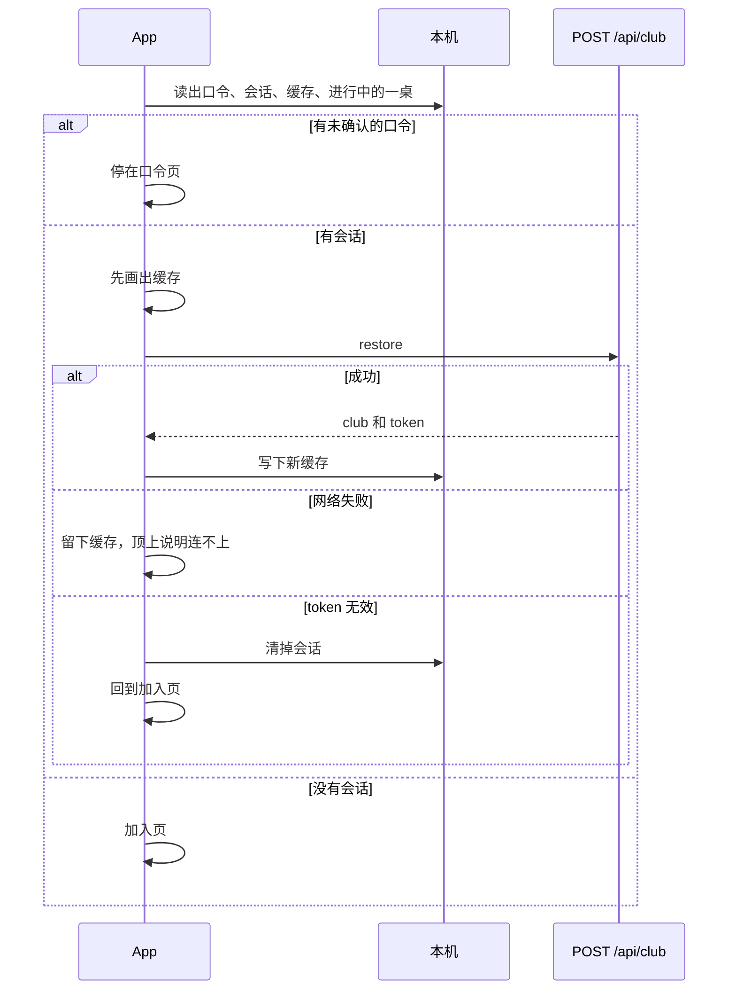
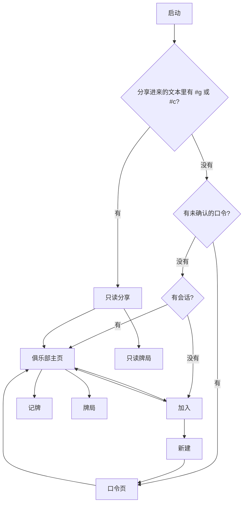

# Android 版方案

朋友之间记一局德州的牌桌，做成一个可以装在安卓手机上的应用。这次只定方案，不写应用。

**推荐：用 Expo（React Native）画一套和现在网页同一气质的界面，输赢和分享链接直接用仓库里的 TypeScript。俱乐部仍走已经在线上的 `POST /api/club`。朋友之间安装签名 APK，不上应用商店。不接 LeanCloud。**

评审可以只看两节：[技术选择](#1-技术选择)、[界面](#2-界面)。[阶段](#3-阶段)很短。

## 这份方案核对过什么

以仓库里的代码为准，不以 README 的「只存在这个浏览器」为准。README 那段已经过时，这次不改写产品说明，只加了指向本文的一行。

当前网页（`src/App.tsx`）用的是 `src/serverClient.ts`，请求打到 `POST /api/club`。开发时由 `vite.config.ts` 里的中间件处理，线上由 `netlify/functions/club.ts` 转发到同一份 `src/server/ledger.ts`。2026-11-26 向 `https://ardxwe-table.netlify.app/api/club` 发送 `{"op":"restore","token":"nope"}`，返回 `{"ok":false,"reason":"missing"}`，说明这个接口已经在生产上，而且错误形状和现在的仓库一致。

`src/leancloud.ts` 和 `docs/leancloud-club-storage.md` 是另一条客户端：双口令、LeanCloud 用户。页面没有引用它，线上包里也没有 LeanCloud。LeanCloud 官方将于 2027-01-12 停止服务，Android 不接入。若还有数据只活在 LeanCloud 上，应在关停前从网页侧导出；那不是这个应用的后端。

Netlify 生产部署要到 2026-12-02 额度恢复后才能再发。本文不依赖一次新的生产部署：原生客户端调用现有接口不受浏览器跨域限制，不需要为 Android 改函数、加响应头或重新发布网站。线上页面文案可能略旧于 `main`，界面以仓库里的 `src/App.tsx` 为准。

## 产品现在在做什么

一台手机、一家俱乐部、一桌进行中的牌。没有账号、支付、抽水，也不记录每一手牌。

一家俱乐部有一个名字和一把口令。口令由应用生成，8 位，字符集是 `ABCDEFGHJKLMNPQRSTUVWXYZ23456789`（去掉了 I、O、0、1）。服务器只存口令的 SHA-256 十六进制，俱乐部 id 就是这个哈希。知道口令的人都能看、都能记、都能删。网页上的「写口令」没有单独的入口：`handleClubRequest` 创建时把 `writeHash` 写成和读口令相同的哈希，保存和删除只认会话 token。Android 按这一套做，不要按 LeanCloud 那份文档做成两把口令。

记完的一局是：

```ts
type Game = {
  id: string
  title: string          // 可空
  playedAt: string       // ISO 时间
  oneBuyIn: number       // 单次买入，至少 1
  players: {
    name: string
    buyIns: number
    left: number
    net: number          // left - buyIns * oneBuyIn
  }[]
}
```

进行中的一桌不上传。它是 `{ oneBuyIn, players: { id, name, buyIns, left } }`，`left === null` 表示还没点筹码。默认单次买入是 200。

输赢和排名的规则以 `src/ledger.ts` 为准，下面这些容易在重写时被「改好」：

- 净筹码 = 剩下的 − 买入次数 × 单次买入。还没填「剩下」的人，净筹码为空，不进已保存的那一局。
- 可以在桌子不平的时候保存。`Off by` 只是提示，不为零也不禁用 Save。
- `Off by` = 已填「剩下」的人的筹码合计 − 这些人的买入合计。还没填的人会计入 Total buy-ins 和 Total in，但不计入 Off by。
- 保存时同名（忽略大小写、去掉首尾空格）合并成一行。没名字或没填「剩下」的人整行丢掉。一行都不剩则不保存。
- 排名按净筹码从高到低，相同则按名字排序。局数是这个人出现过的牌局数，不是买入次数。
- 历史按 `playedAt` 从新到旧。
- 保存成功后，有名字的人留在桌上，买入次数回到 1，「剩下」填成单次买入（净筹码为 0）。没名字的人去掉。
- 买入次数可以为 0，不能为负。输入里出现非数字就忽略。单次买入小于 1 的输入忽略。
- 金额用 en-US 千分位。正数 `+1,200`，负数用 Unicode 减号 `−1,200`（U+2212），零是 `0`。
- 时间用 en-US，例如 `Nov 26` 和 `8:10 AM`。有牌局标题时，标题做标题，时间退到表格下面；没有标题时，时间本身就是标题。

分享是只读快照，数据在网址的 hash 里，不上传：

- 一局：`https://ardxwe-table.netlify.app/#g=` + base64url(UTF-8 JSON)
- 一整家：`https://ardxwe-table.netlify.app/#c=` + 同样的编码，游戏数组
- 空俱乐部不能分享。`#c=` 的 token 超过 60000 字符时，网页显示 Too big，不生成链接。
- hash 里同时有 `c` 和 `g` 时，只认俱乐部。
- 打开分享不需要口令，也不能从分享写回服务器。

## 1. 技术选择

### 推荐的栈

Expo（React Native），用预构建得到普通的 Android 工程，在本机打出 **release APK**。界面用 React Native 重画，不包一层 WebView。最低系统 Android 8（`minSdk 26`），只打 `arm64-v8a`；朋友里如果还有 32 位手机，再加 `armeabi-v7a`。

选它，是因为这个产品的风险在规则和链接，不在控件。

`src/ledger.ts` 和 `src/share.ts` 不碰 DOM，已经由 `npm test` 里的 `src/ledger.test.ts`、`src/share.test.ts` 锁住。Android 引用这两份文件，网页能打开手机发出的链接，手机也能解开网页发出的链接。界面只有一列纸色表格，重画的工作量小于把 base64url 和净筹码再实现一遍。

Expo 在这里只负责工程、系统分享、剪贴板和打包。发给朋友的是签名 APK，不是 Expo Go，也不需要 Expo 账号才能安装。依赖里不要放 Google Play 服务、FCM 或地图，华为等没有 GMS 的手机才能装上就用。

iOS 留在同一套界面上以后再做。这次的产物只有 Android。

### 和网页共用哪部分

以后应用放在本仓库的 `apps/mobile`，单独的 `package.json`，不把网站改成 npm workspace。Metro 通过 `watchFolders` 看到仓库根上的 `src/`。

可以直接引用、加载时没有浏览器 API 的：

| 模块 | 用途 |
| --- | --- |
| `src/ledger.ts` | 净筹码、汇总、排名、把一桌收成一局、生成 id |
| `src/share.ts` | `#g=` / `#c=` 的编解码和网址 |

不要从应用引用这些文件：

| 模块 | 原因 |
| --- | --- |
| `src/clubs.ts` | 底部的 `browserClubs` 在加载时就读 `localStorage`。`digestSecret` 和 `generatePassword` 本身是纯的，但现在和浏览器账本在同一个文件里 |
| `src/storage.ts`、`src/serverClient.ts` | 绑在 `localStorage` / `sessionStorage` 和相对路径 `/api/club` 上 |
| `src/leancloud.ts`、`src/cloud.ts` | 双口令云客户端。`cloud.ts` 一加载就会带上 `clubs.ts` |
| `src/App.tsx` | 网页界面 |

实现时的第一小步（另一次改动，不是本方案要做的）：把 `digestSecret`、`generatePassword` 留在加载时不碰存储的模块里，`browserClubs` 挪走。网页测试保持通过。完成之前，应用不要 import `src/clubs.ts`。口令算法就是：trim 之后做 SHA-256，输出小写十六进制。

`share.ts` 内部用 `./ledger.ts` 这种带后缀的引用。不要为了手机去改网页的 import（node 测试依赖现在的写法）。Metro 若不接受 `.ts` 后缀，在应用的解析配置里处理。

运行时需要 `TextEncoder`、`btoa` / `atob`，以及 `crypto.getRandomValues`（`newId` 和生成口令）。当前 Expo 的 Hermes 具备这些。`crypto.subtle` 只在拆开 `digestSecret` 之后才需要；若某次 SDK 没有 Web Crypto，只在应用入口补 polyfill，不改函数本身。

验收：用现有 node 测试造出一个 `#g=` / `#c=` token，应用解开后和网页一致；应用生成的 token，`decodeGameShare` / `decodeClubShare` 能还原。逻辑测试继续跑在网页这份文件上，不必译成另一门语言。

俱乐部请求不要复用 `serverClient.ts` 的代码，复用它的协议。应用自己发 POST，base URL 可配置：

- 生产：`https://ardxwe-table.netlify.app/api/club`
- 开发：电脑上 `npm run dev` 的地址。模拟器用 `http://10.0.2.2:5173/api/club`，真机用局域网 IP。明文 HTTP 只留在 debug 构建。

分享出去的网址永远用生产源 `https://ardxwe-table.netlify.app/`，这样没装应用的人仍用浏览器打开。不要用自定义 scheme 当主链接。

### 本机存储

数据量就是一家俱乐部、几年的周末牌局，一份 JSON 就够。用 AsyncStorage，键名和网页对齐，方便以后对脏数据：

| 键 | 内容 |
| --- | --- |
| `felt.session.v1` | 进行中的一桌。每次改买入、筹码、名字都写进去。进程被杀掉也还在 |
| `felt.server.token.v1` | 会话 token。有它就表示已经加入一家 |
| `felt.server.club.v1` | 最近一次成功拿到的俱乐部（名字、哈希、牌局） |
| `felt.server.issued.v1` | 新建后还没点 Enter club 的口令。杀进程再打开，仍停在口令页 |

网页把 token 同时放在 `sessionStorage` 和 `localStorage`，是为了多个标签页。手机只有一份，持久保存即可。

威胁模型和网页的 localStorage 相同：口令在这台已解锁的手机上。不要为朋友局上 SQLCipher。加密存储可以以后再做。

进行中的一桌是整台设备一份，不按俱乐部分开。换一家俱乐部时，桌上的人还在；下一次保存进当前打开的那家。这和网页一致。按俱乐部分开草稿是以后的事。

应用私有目录即可，不申请存储权限。以后若要导入文件，用系统文件选择器。

### 俱乐部同步

同步是「有网就用服务器上的历史，没网就看上次的缓存，进行中的一桌永远在本机」。不要做第二套云，也不要做账号。



请求体是 JSON，`Content-Type: application/json`。成功时 `{ ok: true, token, club }`，`club.games` 已按时间从新到旧排好。失败时 `{ ok: false, reason }`。

| op | 何时 | 主要字段 | 失败 |
| --- | --- | --- | --- |
| `create` | 新建 | `name`，`readPassword`，`games: []` | `empty` 没名字或没口令；`name` 名字已被用（忽略大小写）；`read` 口令碰撞；`failed` 服务器出错 |
| `open` | 加入 | `readPassword` | `missing` 口令空或不存在 |
| `restore` | 冷启动 | `token` | `missing` 会话失效 |
| `refresh` | 从后台回到前台，且已经打开一家 | `token` | 失败时保持当前画面，不要把人踢出去 |
| `save` | 保存一局 | `token`，`game` | `missing` 会话失效；`failed` 这局数据不合法 |
| `delete` | 删除一局 | `token`，`gameId` | `missing`；`failed` 没有 id |

`import` 是网页把浏览器里的旧牌局补进空俱乐部。Android 没有那份旧数据，MVP 不调用。`unlock` 在现在的服务器上不检查写口令，页面也没用它，不要做。

创建时的口令和网页一样：本机生成，碰撞（`read`）就换一把，最多 5 次。名字冲突立即停下，让人改名字。

保存和删除成功之后，用响应里的 `club` 覆盖缓存。失败则进行中的一桌原样留下，并显示网页上的那句英文。从后台回来时刷新；若这次刷新返回时，用户已经换了一家，丢掉这次结果（网页用 `clubGeneration` 防的就是这个）。

两部手机同时各记一局，是两次按 id 新增，不会整份互相覆盖。删除也是按 id。MVP 不做离线队列：没网时保存失败，人还坐在桌上，和网页一样。队列放在后面，因为接口已经是按 id 写入，补上队列时不用改服务器。

连不上时的界面：有缓存就画缓存，并在排名上方显示 `Could not reach the server. Showing the last saved games.` 冷启动还没有缓存时先显示 `Opening club…`。若这次启动失败，而且本机没有俱乐部缓存，回到加入页，不加一句新的错误——网页的 restore 失败也是这样。`Could not open the club. Try again.` 只出现在用户点了 Join、请求又失败的时候。

### 分发

这是三五个朋友用的牌桌，不是要上架的产品。

- 维护者在本机打 release APK，自己保管签名密钥，密钥不进仓库。
- 主产物是 APK，不是给 Play 用的 AAB。版本号随每次发包递增。
- 国内应用商店通常要软著和主体资质，和这个使用方式不匹配。Google Play 在国内也不是朋友的安装路径。
- 传递：面对面传文件，或打成 zip 再发。微信经常拦截或改写 `.apk`，zip 更稳。不要把「先把 APK 部署到 Netlify」当作安装方式，那会碰上传生产部署。额度恢复之前用本地传递。
- 安装：Android 8 起按来源允许安装。应用不请求多余权限，安装说明就是这一句。
- 更新：再发一个 APK。应用里检查更新、蒲公英一类内测平台，都以后再说。
- 开发机在国内拉 Gradle 依赖时通常要镜像。这是实现时的环境问题，Flutter 打 Android 包也会遇到，不改变技术选择。

### 另外三条路

**Flutter。** 维护者机器上已经有 Flutter，`~/codes/trader` 是另一个 Flutter 工程，所以编译移动包本身没有障碍，iOS 以后也会少一条技术栈。不选它，是因为这份仓库里必须和网页逐字节一致的部分已经是 TypeScript，而且有测试。译成 Dart 之后，分享链接和净筹码会有第二份实现；这个应用真正会坏的地方就是那里。界面只有几屏，盖不过这个成本。

**Kotlin 与 Jetpack Compose。** 安卓界面能做得最贴系统，但规则同样要重写一遍，README 里的 iOS 还得再做一次。牌桌用不到只有 Android 才有的系统能力。

**Capacitor 或 WebView，把现在的网站包进去。** 最快，也最不像一个单独的客户端。进行中的牌桌已经是按手机写的网页。包进 WebView 之后，俱乐部请求仍要打到一个源；生产部署暂停时，包里的页面和线上函数还可能不是同一次发布。网址 hash 也不会进 Android 的 App Link，点开 `#g=` 仍然进浏览器。浏览器本来就能打开这个网站。Android 版要解决的是：牌桌数据在应用私有存储里，分享和加入走系统界面，并且按仓库里的协议说话。

## 2. 界面

网页是一个状态切换的单页，不是多标签。Android 同样用一条返回栈，不要底栏，也不要抽屉。手机上内容通栏铺在纸色背景上，左右内边距 16dp。平板和横屏把内容限制在约 520dp 宽、水平居中，背景仍是整屏纸色。这对应网页手机通栏、宽屏约 44–46rem 的版心。

系统返回和顶栏上的文字按钮做同一件事。确认条出现时，返回等于 Cancel。



| 网页上的状态 | Android 屏幕 |
| --- | --- |
| 加入（`askingPassword`，未在新建） | 加入 |
| 新建俱乐部 | 新建 |
| 刚生成的口令（`issued`） | 口令页 |
| `Opening club…` | 主页的加载句，不是单独的闪屏 |
| 俱乐部主页，尚无牌局 | 主页空状态 |
| 排名 + 折叠的历史 | 主页 |
| 历史里确认删除 | 主页里的一行确认，不新开页面 |
| 打开一局 | 牌局 |
| New game、保存前填名字、清空确认 | 记牌，后两步是同一屏上的操作条 |
| `#g=` 一局 | 只读牌局 |
| `#c=` 一家，以及从里面再点开一局 | 只读主页，再进入只读牌局 |

网页没有地址栏以外的「打开链接」。Android 没有会把 hash 交给应用的 App Link，所以分享进应用的路径是：其他应用把文本分享给它，或用户把链接交给「Open link」。解开之后仍是只读快照，不加入俱乐部，也不能编辑。这是地址栏的替代，不是新能力。

### 视觉

和 `src/styles.css` 同一套颜色，不要套 Material 的默认紫色，也不要卡片阴影。

| 用途 | 色值 |
| --- | --- |
| 纸色背景 | `#f7f2ea` |
| 输入底 | `#fffcf8`，聚焦前的白底输入用 `#ffffff` |
| 字 | `#1c1814` |
| 次要字、零、文字按钮 | `#746b62` |
| 分割线 | `#e6d9c8` |
| 输入框边 | `#e3d5c4`，聚焦时 `#176b3f` |
| 主按钮（New game、Join、Save、Add） | `#176b3f`，按下 `#125833`，白字 |
| 危险（Remove、确认删除） | `#b42318`，按下 `#9a1d14` |
| 名次 1 的圆点 | 底 `#176b3f`，字白 |
| 其他名次的圆点 | 底 `#efe4d6`，字 `#5e564e` |
| 赢（净筹码 > 0） | `#b42318` |
| 输（净筹码 < 0） | `#157a45` |

赢是红色，输是绿色，和网页一致，也和国内「红涨绿跌」一致。不要改成欧美行情软件那种绿涨红跌。

俱乐部名字用衬线（Android 上的 serif / Noto Serif），约 22sp，字重 500。金额、净筹码、汇总数字也用衬线，并使用等宽数字。其余用系统无衬线。口令用等宽，约 24sp，字距拉开。状态栏和导航栏同纸色，深色图标。

分割线 1px。按钮最小高度 48dp，圆角 10dp。网页在窄屏上的步进按钮大约只有 30px，牌桌上太小；Android 的 `−` / `+` 热区用 48dp，外观仍是细边框的方按钮。输入圆角约 11dp。

英文文案沿用网页，一桌人才不会一边看手机、一边看电脑对不上词。中文界面以后再做。下面线框里的字就是界面上的字。

### 加入

没有会话，且不是在看分享时出现。标题是 `Poker club`。顶栏没有 New game。

```text
Poker club

Join a club

Club password
┌─────────────────────────┐
│ ••••••••            Show │
└─────────────────────────┘

┌─────────────────────────┐
│        Join club        │  绿底
└─────────────────────────┘

Create a club                 灰色文字
Open link                     灰色文字

No club for that password.    出错时才出现，灰色
```

- 口令框默认隐藏，旁边用 `Show` / `Hide` 切换。这是安卓密码框的常规做法，网页用的是浏览器自带的密码框。
- Join 成功：写入 token 和俱乐部，进入主页。
- 口令没有对应俱乐部：`No club for that password.`
- 网络或其他失败：`Could not open the club. Try again.`
- 已经打开着一家又点了 Switch club：多一个 `Back to {俱乐部名}`，回到原来的主页，不清除进行中的一桌。
- Open link：读剪贴板或弹出粘贴。能解开 `#g=` 或 `#c=` 就进入只读页；解不开显示 `That link is not a shared game.`
- 系统返回：若是从某家俱乐部进来换俱乐部，回到那家；否则回到桌面。

### 新建

从加入页进入。系统返回回到加入。

```text
Poker club

Create a club

Club name
┌─────────────────────────┐
│                         │
└─────────────────────────┘

We'll generate a club password. Save it to
return later, and share it with friends who
should be able to join and edit games.

┌─────────────────────────┐
│       Create club       │
└─────────────────────────┘

Back to join
```

网页在「这台浏览器里还有旧牌局」时会多一个勾选，把那些局搬进新俱乐部。Android 没有那份浏览器数据，MVP 不显示这个勾选。

- 名字为空：`Add a club name.`
- 名字已被使用：`That club name is already used.` 名字留在输入框里。
- 其他失败：`Could not create the club. Try again.`
- 成功：进入口令页，口令已写入 `felt.server.issued.v1`。

### 口令页

新建成功后出现。进程重启也还在，直到点 Enter club。顶栏不放返回类按钮，避免没看口令就进了俱乐部。系统返回键不把这一页弹出；回到桌面用 Home。口令已经写在本机，下次打开仍是这一页。点 Enter club 才清掉 `felt.server.issued.v1`。

```text
Poker club

Club password

Copy and save this password before entering.
Use it to return to your club or share it with
friends so they can join and edit games.

A7K2M9QX              Copy password

┌─────────────────────────┐
│       Enter club        │
└─────────────────────────┘
```

Copy password 写入剪贴板，按钮变成 `Copied`。同时提供系统分享，把这 8 个字符分享到微信，这是「复制给朋友」在手机上的做法。Enter club 进入主页。此时俱乐部是空的。

### 俱乐部主页

标题是俱乐部名，过长单行省略。右侧是绿底 `New game`。冷启动有 token 但缓存还没画出来时，正文只有一句 `Opening club…`。

```text
Friday night              [ New game ]

Could not reach the server. Showing the last
saved games.                    仅离线且有缓存

Ranking              Games     Net
────────────────────────────────────
(1) Alex                 6   +2,400
(2) Sam                  6   −1,200
(3) Ren                  4        0

Game history                       >
────────────────────────────────────

Switch club                  Share club
Open link
```

- 没有牌局：正文是 `No games yet`。不显示排名和历史，底栏只有 Switch club 和 Open link，没有 Share club。New game 仍在。
- 排名：只有第一行的圆点是绿色白字，净筹码并列时第二行也不涂绿。其余圆点是米色。净筹码右对齐，赢红输绿，零为灰色。人数多就整页滚动，顶栏贴住。
- Game history 默认收起，`>` 朝右；展开后朝下。收起或展开时，若正在确认删除，取消确认。
- 展开后每一行：有标题就标题在上、时间在下；没标题就时间作为一行。右侧是 `Share`，再右侧是 `Remove`，三个部分保持在同一行，标题过长就省略。网页窄屏把这一行收成两列，Remove 会掉到下一行；手机上把它放稳。行高足够手指点中。
- Share 把 `https://ardxwe-table.netlify.app/#g=...` 交给系统分享，并复制到剪贴板。成功时该按钮短暂变成 `Link copied`。复制失败时分享面板仍在，按钮变成 `Copy the link`。
- Share club 同样处理 `#c=`。token 超过 60000 字符时不分享，按钮变成 `Too big`。
- Remove 把这一行换成确认，不跳页：

```text
Remove this game?
[ Remove ]  [ Cancel ]
```

Remove 是红底。失败时在这行下面显示 `Could not remove that game.` 成功后刷新列表；若正打开的就是这一局，回到主页。

- 底栏 `Switch club` 进入加入页，当前俱乐部还在，可以 Back。
- 从后台回到前台：静默 `refresh`。失败只把离线条打开，不打断正在看的内容。

### 牌局

从历史点进去。顶栏标题是牌局标题，没有标题则是时间。右侧是 `Share game` 和 `← My club`。

```text
Friday                  Share game   ← My club

Name            Buy-in    Left      Net
────────────────────────────────────────
Sam                  1     500   +300
Alex                 2     100   −300

                    Buy-in 200    Nov 26, 8:10 AM
```

有标题时，时间出现在右下这条里；标题已经是时间时，右下只留 `Buy-in 200`。名字过长省略。行按净筹码从高到低。`← My club` 和系统返回都回主页，并尽量回到点进来之前的滚动位置。

### 记牌

顶栏标题 `New game`，右侧文字按钮 `My club`。系统返回同样回主页，桌上的内容留在本机。没有打开俱乐部时不能进入这一页（和网页一样，避免记完才发现没处保存）。

窄屏网页把每个玩家排成两行。Android 以这个布局为准：

```text
New game                          My club

One buy-in                    ┌──────┐
                              │  200 │
                              └──────┘
──────────────────────────────────────

┌────────────────────┐              ×
│ Alex               │
└────────────────────┘
[ − ] [ 2 ] [ + ]   ┌──────┐    +200
                    │  600 │
                    └──────┘
──────────────────────────────────────

Saved players ▾          只有俱乐部里有还没入座的名字时才出现
┌──────────────┐  ┌──────────┐
│ Name         │  │   Add    │
└──────────────┘  └──────────┘

Total buy-ins   Total in   Total left   Off by
2               400        600        +200

┌──────────────┐  ┌──────────────┐
│  Save game   │  │    Clear     │
└──────────────┘  └──────────────┘
```

- One buy-in、买入次数、剩下的筹码都用数字键盘。步进只改次数。
- 净筹码未填时显示 `—`，灰色。已填则实时计算，红或绿。
- `×` 移走这个人。网页窄屏把 Remove 收成 `×`，这里同样收成 `×`，无障碍标签仍是 Remove。
- Saved players 来自这家俱乐部排名里的名字，去掉已经坐在桌上的（忽略大小写）。选中即入座，买入次数为 1，「剩下」为空。
- Add 把输入框里的名字入座。空名字无效。已在桌上的名字再加一次无效。
- 四个汇总始终可见，放在操作按钮上方。320dp 宽的机器若四个数挤不下，改成两行两列，文案不变。
- Save game 在「至少有一个有名字、并且填了剩下筹码的人」之前禁用。桌子不平也可以保存。
- Clear 在桌上没人时禁用。

点 Save game 后，操作条换成：

```text
┌────────────────────────────┐
│ Game name (optional)       │
└────────────────────────────┘
[ Save ]    [ Cancel ]
```

Save 把这一桌收成一局再 POST `save`。成功：缓存更新，回到主页，有名字的人留在桌上（买入 1，剩下 = 单次买入），「Name」输入框清空。失败：停在记牌页，这一桌还在，下面显示 `Could not save. This game is still here.` 会话没了则显示 `Create a club before saving this game.` 并留在这一页。

点 Clear 后，操作条换成 `Clear all players?`、红底 `Clear`、`Cancel`。Clear 只清人，不改单次买入，不碰已保存的历史。

### 只读分享

从分享进来的文本，或 Open link，进入这里。不读取、不替换本机俱乐部。

一整家时，主页结构同上，但：

- 顶栏标题是 `Poker club`（分享快照里没有俱乐部名字；网页也只在打开自家俱乐部时用名字）。
- 排名上方一条：`Shared club · read only`。
- 没有 New game，也没有 Switch club 和整家的 Share club。顶栏是 `Open app`。
- 历史默认仍是收起的。展开后每行仍可 Share，没有 Remove。空的俱乐部分享在网页上编不出来（`decodeClubShare` 遇到空数组就是失败），这一页不会出现「还没有牌局」。
- 点进一局后，顶栏是 `← Club`，回到这份只读俱乐部，不是回到自己的主页。没有 Share game（网页在分享态下不显示它）。

只有一局时，直接是牌局表。顶栏是 `Open app`，没有 Share game。

`Open app` 清掉这次分享：有会话进自己的主页，没有会话进加入页。系统返回同样离开分享。

无效链接停留在原来的页面，并显示 `That link is not a shared game.`

### 空、错、离线

| 情况 | 画面 |
| --- | --- |
| 冷启动，有会话，缓存未到 | `Opening club…` |
| 俱乐部没有任何一局 | `No games yet` |
| 有缓存但请求失败 | 画出缓存，顶部 `Could not reach the server. Showing the last saved games.` |
| 保存失败 | 留在记牌页，草稿还在，`Could not save. This game is still here.` |
| 删除失败 | 确认行下方 `Could not remove that game.` |
| 口令不对 | `No club for that password.` |
| 打不开、建不成 | `Could not open the club. Try again.` 或 `Could not create the club. Try again.` |
| 名字占用 | `That club name is already used.` |
| 俱乐部分享太大 | 按钮变为 `Too big` |
| 链接不是分享 | `That link is not a shared game.` |
| 分享态 | `Shared club · read only`，没有记牌和删除 |

离线时 New game 仍可进入，桌上的修改仍写入本机。只有 Save 需要服务器。这和网页相同。

### 可选，以后再做

这些不是现在网页上的能力，MVP 不要做。

- 没网时把保存和删除放进本机队列，网络恢复后按原来的 `game.id` 提交。服务器按 id 写入，队列不会把整家俱乐部盖掉。
- 同一次点击 Save，若请求超时，用同一个 id 再试。现在网页每次点击都会新生成 id，超时后重试可能记成两局。
- 创建请求超时后，用刚才那把口令再 `open` 一次；打开了就进入口令页。
- 中文界面。
- 按俱乐部分开「进行中的一桌」。
- 把网页导出的 JSON 经现有 `import` 送进一家还没有牌局的俱乐部。
- 口令加密后放在本机。
- 应用内检查更新，或使用内测分发平台。
- 若 `ardxwe-table.netlify.app` 在国内变得难用，把同一份 `handleClubRequest` 跑在一台国内小机器上，应用只改 base URL。不为此新设计协议。

## 3. 阶段

### MVP

一个可安装的 APK，能独立完成现在网页上的朋友局：

1. 把口令纯函数从 `browserClubs` 旁挪开。网页测试继续通过。这一步是实现时的第一笔改动，不属于本 PR。
2. `apps/mobile` 引用 `ledger.ts` 和 `share.ts`。用现有测试的 token 做一次往返。
3. 本机持久化进行中的一桌、会话、俱乐部缓存、未确认口令。
4. 做出上面的加入、新建、口令、主页、牌局、记牌、只读分享。
5. 对接现有 `POST /api/club`。不改 `src/server/ledger.ts`，不加接口，不发 Netlify 生产。
6. 本机打出签名 APK，在一部有网的手机和一部飞行模式的手机上走通：记牌、杀进程、保存、离线看缓存、分享链接在浏览器里打开。

### 以后

上面「可选」列表里的内容，加上 iOS。iOS 用同一套 Expo 界面跟进即可，不在这次 Android 里实现，也不单独再选一套技术。

### 这次不做

本 PR 只有这份方案和 README 里的一行指针。没有应用工程，没有依赖变更，没有服务器改动，也没有生产部署。
